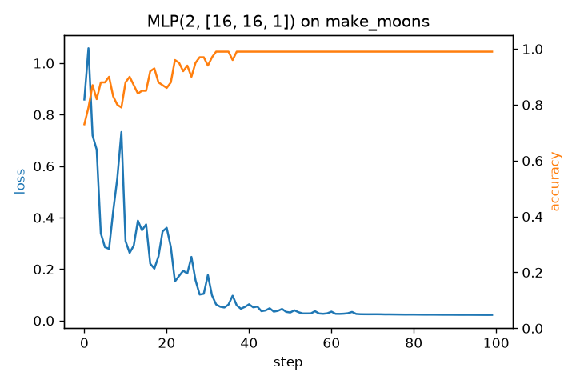
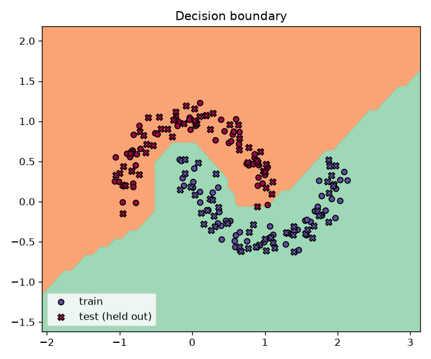

# autograd-numpy

A tiny scalar reverse-mode autograd engine in pure Python, in the spirit of Karpathy's micrograd, with every
gradient checked against finite differences using hypothesis property tests. A `Value` wraps one float and
records the operation that produced it; `backward()` walks the graph in reverse topological order and
applies the chain rule at each node. A small `Neuron` / `Layer` / `MLP` library on top trains a
2-16-16-1 network on `make_moons`: 99% accuracy on 100 training points and 100% on 100
held-out test points (one seed, low-noise data, so treat it as "the engine learns", not a benchmark).

 

## Usage

```python
from autograd_numpy import Value

a, b, c = Value(2.0), Value(-3.0), Value(10.0)
d = (a * b + c).tanh()
d.backward()
print(a.grad, b.grad, c.grad)  # dd/da, dd/db, dd/dc
```

Supported ops: `+ - * /`, `**` (constant exponent), `tanh`, `relu`, plus reflected versions (`2 * v`).

Train the example (needs the `examples` extra, takes ~2 minutes because every number is a Python object):

```bash
uv pip install -e ".[dev,examples]"
python examples/train_moons.py
```

## How this differs from PyTorch

- **Scalars vs tensors.** Each `Value` is one number, so a 337-parameter MLP builds a graph with tens of
  thousands of Python objects per step. PyTorch nodes are whole tensors (one `matmul` node for a full
  layer) and the math runs in vectorized C++/CUDA kernels.
- **Same algorithm.** Both build the graph during the forward pass (define-by-run), then do a reverse
  topological walk calling each node's local backward function and accumulating grads with `+=`.
- **What's missing here:** broadcasting, batching, GPU, `no_grad`, freeing the graph after backward,
  higher-order gradients, and optimizers beyond hand-written SGD.

## Setup

```bash
uv venv --python 3.11
source .venv/bin/activate
uv pip install -e ".[dev]"
```

## Check

```bash
ruff check .
ruff format --check .
mypy
pytest -v
```

## Layout

- `src/autograd_numpy/` — library code
- `src/autograd_numpy/engine.py` — `Value` and its operations
- `src/autograd_numpy/nn.py` — `Module`, `Neuron`, `Layer`, `MLP`
- `examples/train_moons.py` — training loop and plots (saved to `assets/`)
- `tests/` — pytest + hypothesis (`gradcheck.py` holds the finite-difference helper)
- `.github/workflows/test.yml` — CI (Python 3.11, ruff + mypy + pytest)

## TODO

Done:
- [x] Scaffold: uv, `pyproject.toml`, ruff, `mypy --strict`, pytest + hypothesis, GitHub Actions CI
- [x] Smoke test (import + version)

Engine, one commit per item:
- [x] Finite-difference gradient helper `(f(x+h) - f(x-h)) / 2h`, tested on plain Python functions
- [x] `Value` class (`data`, `grad`, `_prev`, `_op`, `__repr__`) + `+` + topological-sort `backward()`
- [x] Hypothesis gradcheck property test for `+`, plus an `a + a` test (grads accumulate with `+=`)
- [x] `*`
- [x] `tanh`
- [x] `relu` (hypothesis inputs kept away from the kink at 0)
- [x] Optional: `-`, `__radd__`/`__rmul__`, `/`, `**`

Neural net:
- [x] `Neuron`, `Layer`, `MLP` with `parameters()` and `zero_grad()`
- [x] Train on `make_moons` (SGD loop: forward, zero grads, backward, update)
- [x] Loss curve and decision boundary plots, saved in the repo
- [x] Pushed, CI green

Wrap-up:
- [x] Real description here and in `pyproject.toml` (replacing the TODO)
- [x] README: usage example, results plot, how this differs from PyTorch tensor autograd
- [x] Held-out test split: train accuracy and test accuracy reported separately
- [x] Keep-or-cut decision for the resume: keep (it trains on make_moons and generalizes to held-out points)

## License

MIT
